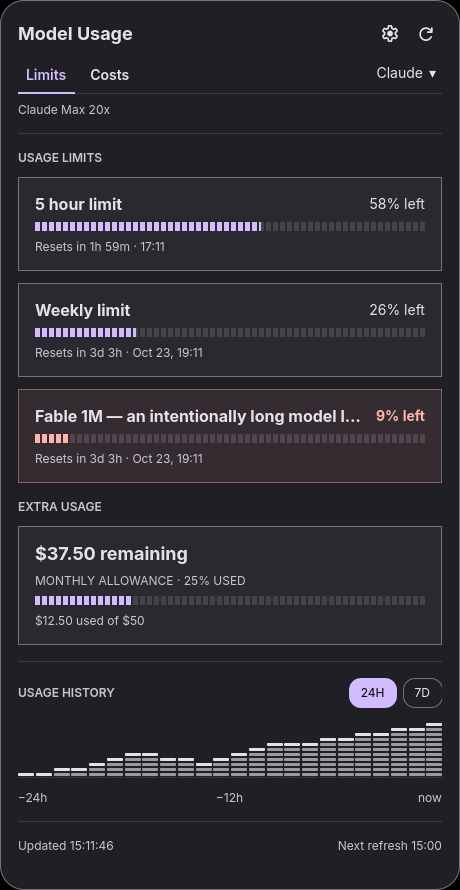
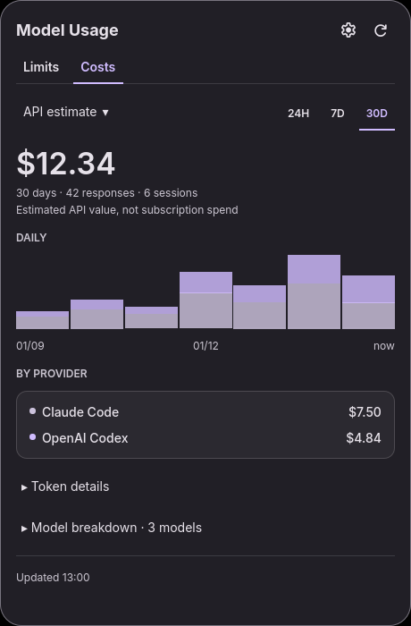
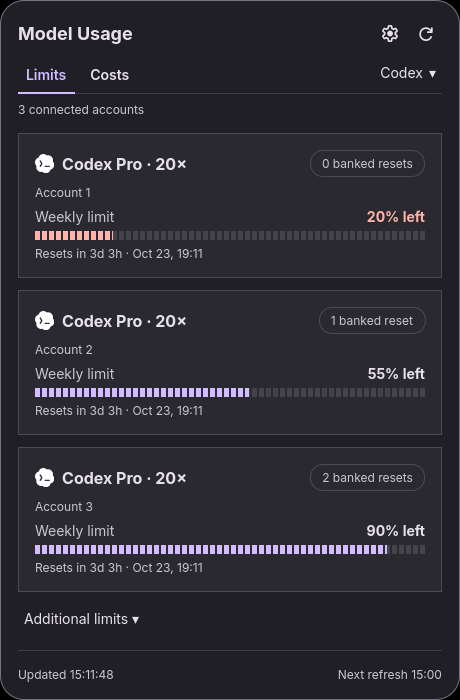

# dms-modelusage

AI subscription limits, account activity, and estimated API costs in
DankMaterialShell. A port of
[DigitalPals/omarchy-modelusage](https://github.com/DigitalPals/omarchy-modelusage)
with DMS colors, typography, plugin settings, and DankBar popouts. Works with
mangowm and other compositors supported by DMS.

## Features

- Local Claude Code, OpenAI Codex, and Kimi Code quotas, reset countdowns,
  credits, and persistent 24H/7D history.
- Fusebox and CLIProxyAPI connections with per-account quotas, private account
  labels, and confirmed Codex banked reset actions where supported.
- Shared Fusebox live session activity and last-used account tracking;
  optional CPA Usage Keeper integration for Go proxies.
- 24H/7D/30D cost estimates from local Codex/Claude transcripts and up to four
  T3 Code servers, with cached prices, custom rates, source diagnostics,
  incremental scans, and duplicate suppression.
- Underlined Limits/Costs tabs, compact provider and metric menus, segmented
  quota meters, and expandable token/model details using the current DMS theme.

See [UPSTREAM.md](UPSTREAM.md) for the incorporated upstream revision and
[configuration](docs/configuration.md) for connection details.

<p>
  
  
  
</p>

Previews use synthetic fixture data and a DMS palette. The installed widget
follows your current DMS theme. Regenerate with `python3 tests/preview docs`.

## Requirements

- DankMaterialShell 1.6 or newer.
- Python 3.10 or newer available as `python3`.
- At least one supported CLI installed and signed in, or a configured proxy:
  - Claude Code: `claude auth login`
  - OpenAI Codex: `codex login`
  - Kimi Code: `kimi login`
- Network access for live quotas, public model prices, and configured remote sources.
- Optional: Python `websockets` 15+ for Fusebox live activity (`python-websockets`
  on Arch). Other collectors use Python's standard library.

Provider CLIs own their sign-in and renewal. Missing live dependencies are
reported in the panel; quota checks continue to work.

## Install

Clone the repository into DMS's user plugin directory:

```bash
mkdir -p ~/.config/DankMaterialShell/plugins
git clone https://github.com/Omgzilla/dms-modelusage.git \
  ~/.config/DankMaterialShell/plugins/modelUsage
```

Then scan/enable it in DMS Settings → Plugins and add **Model Usage** to your
DankBar layout. For an already enabled installation:

```bash
dms ipc call plugins reload modelUsage
```

When upgrading from the original port, restart once with `dms restart` if the
reload fails: Quickshell can cache the component directory before the new files
are installed. For a local checkout, `python3 tests/install` backs up the old
plugin and installs the runtime files without copying Git metadata.

The repository name is `dms-modelusage`; the DMS plugin ID remains `modelUsage`
so existing bar placement and settings continue to work. Existing installations
can update with `git pull` if cloned from this repository. If you installed a
copy, copy the project files into the existing `modelUsage` plugin directory.

## Configuration

The gear in **Limits** configures providers, proxy connections, private account
labels, bar chips, card corners, polling, and warning thresholds. The gear in
**Costs** configures local history, T3 servers, custom prices, and source
diagnostics. Both forms have explicit Save/Cancel controls and are also
available from DMS's plugin settings.

Costs estimates the public API value of recorded tokens, not subscription
billing. Unknown prices preserve token totals; partial history and unavailable
data are labeled. Local cost sources are independent of the selected quota
provider. Kimi supplies quotas but lacks attributable historical model names
for reliable cost estimates.

State is stored privately under:

```text
${XDG_STATE_HOME:-~/.local/state}/DankMaterialShell/model-usage/
```

The existing state location is preserved. New proxy/T3 credentials are stored
separately under `${XDG_CONFIG_HOME:-~/.config}/dms-modelusage/management-keys/`
with private permissions. This avoids putting credentials in a symlinked DMS
dotfiles directory or in plugin settings. Provider environment overrides such
as `CLAUDE_CONFIG_DIR`, `CODEX_HOME`, `KIMI_CODE_HOME`, `KIMI_CODE_BASE_URL`,
and `KIMI_SHARE_DIR` are honored.

## Controls

Click the bar widget to open it. In the panel, `c`/`u` switch Costs/Limits,
`r` or Enter refreshes, `s` opens settings, `p` opens the provider menu,
Left/Right select providers, and Up/Down scroll. In Costs, `m` opens the metric
menu, `d` expands token details, and `b` expands model details. Escape closes
the panel or cancels settings. Tab moves through controls.

Namespaced IPC uses Quickshell's active DMS configuration:

```bash
dms ipc call dms-modelusage limits
dms ipc call dms-modelusage costs
dms ipc call dms-modelusage refresh
dms ipc call dms-modelusage configure
dms ipc call dms-modelusage configureCosts
dms ipc call dms-modelusage status
```

## Development

```bash
python3 tests/run
```

This runs Python and JavaScript regressions plus isolated QML contracts when
Quickshell is installed. Tests use synthetic accounts and temporary private
state; they do not spend real reset credits. `python3 tests/run --qml-only`
runs only the UI contracts. See [UPSTREAM.md](UPSTREAM.md).

For a panel-only diagnostic image, open it and call
`dms ipc call dms-modelusage snapshot`. The image is written to
`$XDG_RUNTIME_DIR/dms-modelusage-panel.png`; it includes the panel's displayed
data and follows the account privacy setting.

## Troubleshooting

If a provider is unavailable, run its normal sign-in command in a terminal and press the refresh button. A missing CLI or failed provider is isolated from the other providers.

If the widget does not appear, verify that `plugin.json` is directly inside `~/.config/DankMaterialShell/plugins/modelUsage`, then run:

```bash
dms ipc call plugins reload modelUsage
```

Quickshell must inherit a `PATH` containing `python3` and the provider CLIs. If DMS was started by a graphical session with a different environment, use absolute executable paths in your session setup or start DMS after the relevant environment has loaded.

## Attribution

The collectors, accounting, account workflows, and panel design are adapted
from DigitalPals' MIT-licensed plugin. See
[THIRD_PARTY_NOTICES.md](THIRD_PARTY_NOTICES.md) and [LICENSE](LICENSE).
